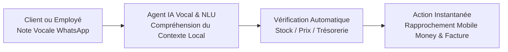

Depuis le début de l'année 2026, l'industrie technologique mondiale assiste à un phénomène sans précédent : la production de code et le déploiement de nouvelles applications ont plus que doublé, dopés par les assistants génératifs et les environnements de développement assistés par l'intelligence artificielle. Chaque semaine apporte son lot de micro-plateformes promettant de révolutionner la gestion client, la prospection ou la comptabilité. 

Pourtant, dans les directions générales de Douala à Abidjan, de Yaoundé à Nairobi, un sentiment d'inachevé prédomine : **la multiplication des outils n'a pas résolu la crise de l'exécution.**

Beaucoup d'entreprises se retrouvent avec des empilements d'abonnements logiciels qui ne touchent jamais directement le résultat final attendu. L'exemple archétypal est celui du recrutement : un outil dopé à l'IA trie et note les 50 meilleurs profils LinkedIn pour un poste ouvert. Mais l'entreprise n'a que faire d'une liste scorée ; ce qu'elle veut, c'est **le candidat qualifié, disponible, aux prétentions salariales vérifiées, assis à son bureau lundi matin.** 

Face à ce constat, une réflexion fondamentale émerge : au lieu de courir après la création de nouveaux gadgets logiciels périphériques, la véritable rupture réside dans une **approche agentique orientée résultat, greffée sur des chaînes de services qui créent déjà de la valeur.** Mais ce paradigme se heurte immédiatement à une question impitoyable : nos entreprises africaines, et particulièrement camerounaises, disposent-elles de la maturité organisationnelle, des processus et de l'hygiène de données nécessaires pour être automatisées ?

---

## 1. La Fracture du Dernier Kilomètre : Du SaaS passif au Service-as-a-Software

*L'économie du logiciel traditionnel vendait du temps d'accès à un outil. L'économie agentique vend du travail achevé.*

Pendant deux décennies, le modèle SaaS (*Software-as-a-Service*) a fonctionné sur une promesse implicite : *"Prenez notre outil, mettez-y vos équipes humaines, et vous serez plus efficaces."* Dans ce schéma, l'effort d'exécution repose toujours à 90 % sur les épaules de l'utilisateur humain. 

```
Modèle Logiciel Passif (Copilote / Outil d'aide) :
Entrée (Données brutes) ──> [ Outil IA de Tri / Dashboard ] ──> Recommandation ──> [ L'humain doit tout exécuter ] ──> Résultat

Modèle Agentique Opérationnel (Service-as-a-Software) :
Entrée (Expression du besoin) ───────────────────────> [ Agent Autonome + Superviseur ] ───────────────────────────> Résultat Garanti
```

L'acheteur B2B ne cherche pas à enrichir sa collection d'onglets de navigateur. Il cherche à éliminer un problème business mesurable. Selon les analyses des fonds d'investissement de référence (Bessemer Venture Partners, Sequoia Capital), le marché mondial du logiciel plafonne autour de 700 à 800 milliards de dollars, tandis que **le marché mondial du travail tertiaire et des services B2B (agences, sous-traitants, cabinets d'audit, BPO) dépasse les 5 000 milliards de dollars.**

La rupture agentique ne consiste pas à vendre un logiciel un peu plus intelligent pour que vos collaborateurs travaillent plus vite. Elle consiste à **remplacer l'intermédiaire opérationnel par un système autonome qui délivre directement l'extrant.**

---

## 2. Le Mur du Réel au Cameroun : Automatiser le désordre produit du désordre automatisé

*Croire qu'une IA peut structurer magiquement une entreprise qui n'a ni processus, ni règles, ni rigueur écrite est une illusion mortelle.*

Avant d'envisager de doubler la valeur d'une entreprise par des agents logiciels, il faut regarder avec honnêteté les réalités du tissu économique camerounais. Comme nous l'analysions dans notre autopsie des fondations d'entreprise en Afrique, la majorité des PME locales évoluent dans un environnement aux antipodes des standards de la Silicon Valley :

- **La primauté de l'oralité et de l'informel :** Dans 85 % des PME à Douala ou Yaoundé, les décisions clés, les commandes de fournitures, les tarifs négociés et les accords partenariaux ne sont consignés dans aucun CRM, mais dispersés dans des notes vocales WhatsApp et des carnets manuscrits.
- **L'absence de SOPs (Standard Operating Procedures) :** Le savoir-faire opérationnel réside exclusivement dans la mémoire du promoteur ou de deux employés de confiance. Si l'employé est absent ou quitte l'entreprise, le processus s'effondre.
- **Le désert de données structurées :** Pas d'historique propre des ventes, des marges par produit ou des comportements clients. Les chiffres disponibles sont souvent parcellaires ou reconstitués a posteriori pour des impératifs fiscaux.
- **L'aléa d'infrastructure permanent :** Entre délestages électriques intempestifs et instabilité des connexions fibre/4G, un système qui exige une disponibilité réseau continue subit des ruptures régulières.

> [!WARNING]
> **Le piège de la greffe technologique artificielle**
> Si vous injectez un agent d'automatisation dans une entreprise où les stocks ne sont pas comptés physiquement chaque semaine, où les prix changent à la tête du client et où les factures d'acompte ne sont pas suivies, l'agent va simplement générer des erreurs critiques à une vitesse industrielle.

---

## 3. La Thèse d'Eden : L'Amplification Agentique sur l'Existant (Brownfield vs Greenfield)

*La fortune technologique de la prochaine décennie en Afrique ne viendra pas de la création de nouveaux besoins abstraits, mais de la démultiplication de services préexistants et solvables.*

La plupart des startups s'épuisent dans des projets *Greenfield* : inventer une nouvelle plateforme, tenter d'éduquer le marché à de nouvelles habitudes et dépenser des millions en acquisition client pour des services non vitaux.

La stratégie la plus résiliente consiste à adopter une approche *Brownfield* : **prendre une chaîne de valeur qui tourne déjà, qui encaisse déjà du cash et qui possède une clientèle fidèle, puis y insérer une architecture agentique pour faire sauter le plafond de verre de la capacité humaine.**

| Secteur de Service Existant | Goulot d'Étranglement Traditionnel | Le Multiplicateur Agentique | Impact Économique Mesurable |
| :--- | :--- | :--- | :--- |
| **Cabinet de Recrutement & Placement** | Un recruteur sature à 4 ou 5 missions simultanées par manque de temps de sourcing et de pré-qualification. | Des agents analysent les CVs, mènent les pré-qualifications interactives (disponibilité, salaire, compétences de base) et planifient les entretiens finaux. | Capacité multipliée par 6 par consultant, maintien du modèle de commission sur succès (15-20 % du salaire). |
| **Transit, Logistique & Dédouanement** | Suivi manuel fastidieux des connaissements, relances téléphoniques incessantes au Port Autonome de Douala. | Agents de monitoring continu des manifestes, alertes proactives de dépotage et génération automatisée des liasses déclaratives. | Réduction des surestaries de 40 %, passage d'une gestion réactive à un engagement de délai garanti. |
| **PME de Distribution B2B** | Commerciaux débordés par la saisie des commandes WhatsApp et les vérifications manuelles de paiements Mobile Money. | Agent WhatsApp conversationnel qui valide les commandes, génère les QR codes/liens MoMo/OM et met à jour le fichier d'inventaire. | Zéro commande égarée, encaissement avant livraison systématique, trésorerie assainie. |
| **Cabinet d'Audit & Conseil Juridique** | Des juristes juniors passent 70 % de leur temps à éplucher des liasses de contrats papier ou à vérifier la conformité OHADA. | Ingestion vectorielle des dossiers d'audit, comparaison automatisée avec la jurisprudence locale et rédaction de la première mouture. | Temps de rendu divisé par 4, transformation du Taux Journalier Moyen en forfait d'intervention à haute valeur. |

---

## 4. Le Grand Saut Technologique : L'Agentique comme « Leapfrogging » de la Bureaucratie

*Pourquoi forcer nos entreprises à adopter les ERPs lourds du siècle passé quand l'IA peut directement comprendre leur langage naturel ?*

L'Afrique subsaharienne n'a jamais déployé de réseau cuivré de téléphonie fixe sur tout son territoire ; elle est passée sans transition au téléphone portable. Elle n'a pas attendu la bancarisation par agence pour faire circuler l'argent ; elle a inventé le Mobile Money.

Le même phénomène de saut technologique (*leapfrogging*) est en train de s'ouvrir pour la gestion d'entreprise. 

Les grandes suites logicielles occidentales (SAP, Oracle, voire des ERPs comme Odoo mal calibrés) imposent aux collaborateurs des PME africaines une discipline de saisie rigide, antinaturelle et chronophage. Le taux de rejet par les équipes terrain dépasse souvent les 70 %.



L'IA agentique change la donne : **elle ne demande plus à l'humain de parler le langage de l'ordinateur ; c'est l'ordinateur qui apprend enfin à écouter l'humain.**

Un livreur ou un commercial n'a plus besoin d'ouvrir un formulaire à 15 champs sur un ordinateur portable :
> *« Patron, je viens de livrer 50 cartons de savon chez M. Kamga à Akwa. Il a payé 350 000 FCFA par Orange Money, voici la capture du SMS. »*

Un agent connecté au compte WhatsApp de l'entreprise :
1. Écoute la note vocale ou lit le message,
2. Extrait l'identité du client, les quantités et le montant,
3. Vérifie l'authenticité de la transaction Mobile Money,
4. Décrémente le stock dans le système central,
5. Génère et archive la facture conforme au format PDF.

Ce n'est pas de la science-fiction : c'est l'application concrète d'agents spécialisés utilisant les technologies de transcription vocale et de raisonnement disponibles aujourd'hui. L'informatique s'adapte enfin à l'humain, et non l'inverse.

---

## 5. La Grille de Qualification : Votre entreprise est-elle prête pour les agents ?

*Avant de dépenser un franc dans des développements d'agents, voici l'évaluation impitoyable de maturité à mener.*

```
                              NIVEAU DE STRUCTURE DOCUMENTÉE
                                 Faible                   Élevé
                        ┌────────────────────────┬────────────────────────┐
                  Élevé │        ZONE 2          │        ZONE 1          │
                        │  Leapfrogging Léger   │   Agentique Total      │
                        │  (Agents conversation- │  (Automatisation bout  │
FLUX DE CASH & VOLUME   │   nels WhatsApp/Vocal) │   en bout du service)  │
DES TRANSACTIONS        ├────────────────────────┼────────────────────────┤
                 Faible │        ZONE 4          │        ZONE 3          │
                        │  Zone de Danger       │   Informatisation      │
                        │  (Revoir le Business   │   Classique d'abord    │
                        │   Model en urgence)    │   (Tableurs & Outils)  │
                        └────────────────────────┴────────────────────────┘
```

### Zone 1 : Les Champions de l'Échelle (Prêts immédiatement)
* **Caractéristiques :** Volumes transactionnels élevés, procédures écrites, clients réguliers, solvabilité prouvée.
* **Action recommandée :** Déploiement d'agents autonomes sur les goulots d'étranglement (service client, recouvrement, facturation, pré-recrutement).

### Zone 2 : Le Cœur Économique Africain (Cible reine du Leapfrogging)
* **Caractéristiques :** Fort volume d'affaires, trésorerie active, mais gestion essentiellement orale, informelle et sur WhatsApp.
* **Action recommandée :** Ne pas tenter d'installer un ERP lourd. Mettre en place une passerelle agentique invisible qui se nourrit de l'audio et des échanges WhatsApp pour créer la rigueur sans froisser les habitudes.

### Zone 3 & 4 : Les Entreprises en Survie ou en Recherche de Modèle
* **Caractéristiques :** Chiffre d'affaires erratique, absence de clients prévisibles, proposition de valeur floue.
* **Action recommandée :** **Interdiction formelle de toucher à l'IA.** Le problème n'est pas technologique, il est commercial et stratégique. Le temps et le cash doivent être consacrés à trouver des clients payants, pas à coder des agents.

---

## 6. La Transformation du Modèle d'Affaires : Tuer le TJM, Embrasser l'Impact

*Si vous travaillez dix fois plus vite grâce aux agents, vous ne pouvez plus vendre votre temps à l'heure.*

Pour les agences, cabinets de conseil, développeurs et prestataires de services camerounais, l'adoption de l'IA agentique impose une révision déchirante mais salutaire du modèle de monétisation :

1. **La mort annoncée de la facturation horaire :** Vendre un audit ou une mission au taux journalier (TJM) devient suicidaire lorsque des agents permettent de finaliser la mission en 3 heures au lieu de 4 jours. Continuer à facturer au temps passé revient à se pénaliser soi-même pour son efficacité.
2. **La tarification au résultat (*Outcome-based Pricing*) :** Facturer à l'effet produit pour le client. Dans le recrutement, facturer à l'embauche réussie. Dans la prospection, facturer au rendez-vous qualifié effectivement tenu. Dans la gestion logistique, facturer au conteneur dédouané dans les délais impartis.
3. **La métamorphose des marges :** En passant d'un modèle de prestation humaine pure (marge brute de 25-35 %) à un modèle hybride de *Service-as-a-Software* supervisé par des experts (marge brute de 65-80 %), l'entreprise s'offre la trésorerie nécessaire pour investir dans sa recherche, sécuriser son infrastructure électrique et fidéliser ses meilleurs talents.

---

## 7. Conclusion : Le Pragmatisme comme Seule Boussole Technologique

Le débat sur l'intelligence artificielle en Afrique souffre trop souvent d'une dichotomie stérile : d'un côté, les technophiles béats qui s'imaginent que les LLMs vont résoudre comme par magie les problèmes structurels du continent ; de l'autre, les sceptiques immobilistes qui considèrent que tant qu'il y a des délestages et des nids-de-poule, la technologie reste un luxe réservé aux pays riches.

Chez **Grow Tech** et au sein d'**Eden Research & Dev**, nous rejetons ces deux postures. 

L'approche agentique n'est ni un jouet pour faire des démonstrations sur les réseaux sociaux, ni un substitut à la rigueur entrepreneuriale. C'est le levier le plus puissant jamais conçu pour amplifier les organisations qui ont déjà fait le travail difficile : **valider un marché, comprendre intimement les besoins de leurs clients et faire preuve d'une discipline de fer.**

Pour les entrepreneurs, ingénieurs et dirigeants camerounais, la consigne est limpide :
* Ne cherchez pas à copier le dernier logiciel SaaS à la mode à San Francisco.
* Regardez là où votre entreprise ou votre secteur perd du temps, de l'énergie et des contrats à cause de la lenteur administrative et de la friction humaine.
* Bâtissez des agents pragmatiques, connectés à nos canaux réels, capables d'écouter, d'exécuter et de délivrer un résultat irréprochable. 

C'est là, et nulle part ailleurs, que se forgera la souveraineté économique et technologique de notre continent.
